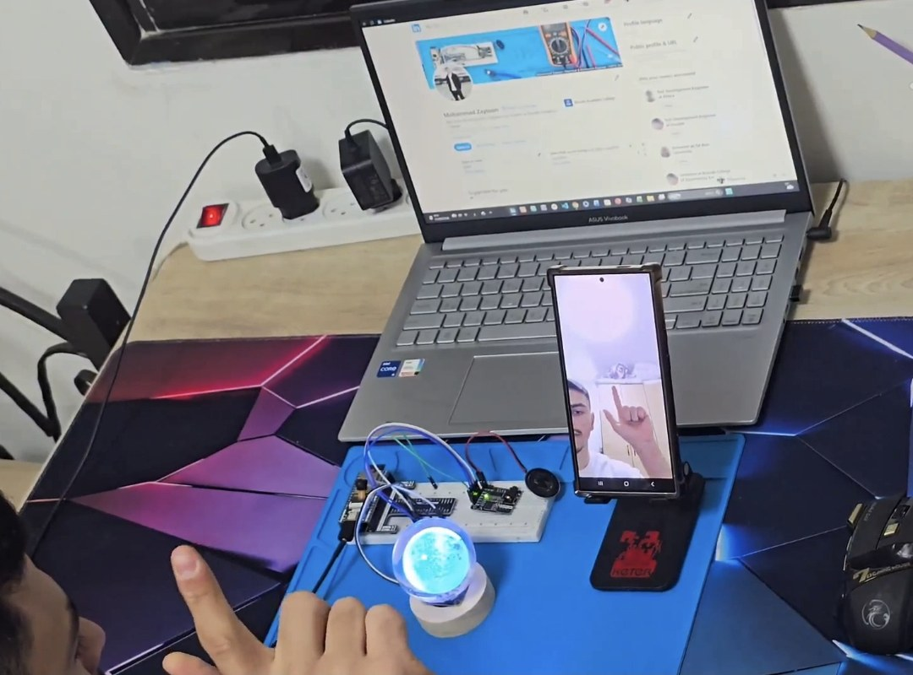
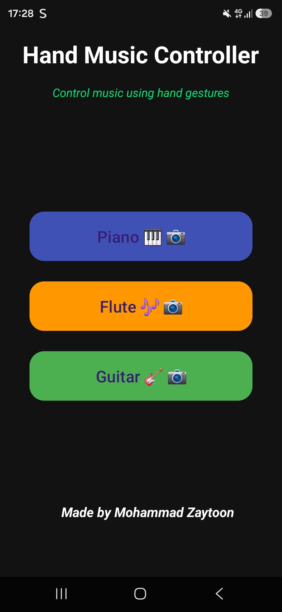
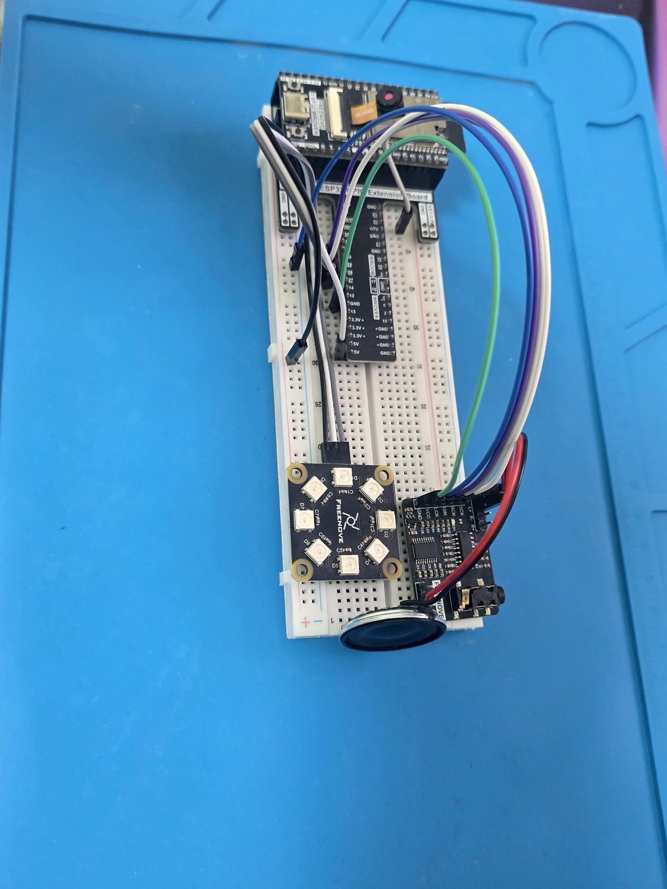

# Hand Music Controller

Play virtual instruments with hand gestures. An Android app uses the phone camera and Google MediaPipe to count raised fingers (1-3 selects the note) and measure hand height (sets the volume). It sends a short text command over Bluetooth Classic to an ESP32, which plays a recorded note (piano, flute or guitar) from an SD card through an I2S audio amplifier and animates an 8-LED ring with an effect for each instrument.



**Demo video:** [watch it on LinkedIn](https://lnkd.in/p/dXRBqwpV)

## How it works

```
Phone camera -> MediaPipe Hand Landmarker -> finger count + hand height
      -> text command over Bluetooth Classic (SPP) -> ESP32
      -> WAV note from SD card -> I2S amplifier -> speaker
                              \-> 8-LED ring animation
```

- **Instrument:** chosen on the app's home screen (Piano, Flute, Guitar).
- **Note:** show 1 finger (index only), 2 fingers (index + middle) or 3 fingers (index + middle + ring) to the front camera. Any other pose, or no hand, stops the sound.
- **Volume:** the higher your hand is in the camera image, the louder it plays.



## Hardware

| Part            | Model                                              |
|-----------------|----------------------------------------------------|
| Microcontroller | Freenove ESP32-WROVER v3.0                         |
| Storage         | microSD 1 GB (on-board slot, SD_MMC 1-bit)         |
| LEDs            | Freenove 8-LED RGB module (WS2812B)                |
| Audio           | Freenove Audio Converter & Amplifier v1.5 (I2S in) |
| Speaker         | 8 ohm, 2 W small speaker                           |
| Phone           | Samsung Galaxy S24 Ultra                           |

The camera that comes mounted on the ESP32-WROVER board is not used in this project.



### Pin mapping

| Function                               | Signal      | ESP32 GPIO |
|----------------------------------------|-------------|------------|
| Audio (I2S)                            | BCLK -> BCK | 26         |
| Audio (I2S)                            | LRC -> LCK  | 25         |
| Audio (I2S)                            | DOUT -> DIN | 22         |
| SD card (SD_MMC, 1-bit, on-board slot) | CLK         | 14         |
| SD card                                | CMD         | 15         |
| SD card                                | D0          | 2          |
| LED ring (8x WS2812B)                  | Data        | 27         |

## Bluetooth protocol

The app sends one line per command: `<CMD>:<VOL>\n`, where `VOL` is 10-100. The ESP32 maps it to an audio volume of 5-12 and an LED brightness of 40-220.

| CMD   | Instrument | File on the SD card |
|-------|------------|---------------------|
| P1-P3 | Piano      | /p1.wav ... /p3.wav |
| D1-D3 | Flute      | /f1.wav ... /f3.wav |
| G1-G3 | Guitar     | /g1.wav ... /g3.wav |
| STOP  | -          | stops audio, LEDs off |

The flute uses the letter `D` in the protocol. The app sends `STOP:0` when no hand or no valid gesture is detected. The ESP32 ignores a command identical to the note that is still playing.

## Repository layout

```
android-app/      Android Studio project (Kotlin)
esp32-firmware/   Arduino sketch for the ESP32
docs/images/      Photos and screenshots
```

## How to run

### 1. ESP32

Tested with:

- Arduino IDE 2.3.8
- Board package `esp32` by Espressif, version 2.0.17
- Board selected: **ESP32 Wrover Module**
- Library **ESP32-audioI2S** (schreibfaul1), version **2.0.0**. Newer versions may change function names, so use 2.0.0
- Library **Adafruit NeoPixel**

Steps:

1. Format the microSD card as FAT and copy nine WAV files to its root: `p1.wav p2.wav p3.wav f1.wav f2.wav f3.wav g1.wav g2.wav g3.wav`. The note recordings are **not included** in this repository. Use any short WAV recordings of single notes.

   **Warning:** the sketch mounts the card with format-on-failure enabled (`SD_MMC.begin("/sdcard", true, true, ...)`). If the card's file system cannot be mounted, it can be formatted and everything on it erased, so use a card with nothing on it that you need.
2. Wire the parts as in the pin table above.
3. Open `esp32-firmware/HandMusicController/HandMusicController.ino`, select the board and port, and upload.
4. The ESP32 appears as the Bluetooth device `Mohammed_Pro_Music`.

### 2. Android app

1. Open the `android-app` folder in Android Studio and let Gradle sync. The project uses Android Gradle Plugin 9.0.1 and Gradle 9.2.1, so use a recent Android Studio. Main libraries: MediaPipe `tasks-vision` 0.10.0 and CameraX 1.3.1. The project's minSdk is 24, but the app asks for the `BLUETOOTH_CONNECT` permission, which exists from Android 12, so Android 12 or newer is expected to be needed. I tested it only on a Samsung Galaxy S24 Ultra (Android 14 or newer).
2. In `MainActivity.kt`, set `DEVICE_MAC` to the Bluetooth address of **your** ESP32. The value in the code is the address of my board.
3. Pair the phone with the ESP32 in Android's Bluetooth settings.
4. Run the app on a physical phone (it needs the camera and Bluetooth), grant the camera and Bluetooth permissions, and choose an instrument.

## Gesture accuracy

A simple test with the piano: I showed each gesture to the camera 20 times, at the normal distance shown in the demo video, and counted how many times the correct note played. One person (me), my own setup, so treat it as a rough indication, not a benchmark.

| Gesture        | Correct notes                    |
|----------------|----------------------------------|
| 1 finger       | 20 / 20                          |
| 2 fingers      | 19 / 20 (one attempt got stuck)  |
| 3 fingers      | 17 / 20                          |

The 3-finger gesture was the hardest one to detect.

## Problems I ran into

- **Fake-sounding notes.** My first version synthesized the tones on the ESP32, and they sounded artificial. I found the board's SD card slot, put real recordings of instrument notes (WAV files) on the card, and played them with the I2S audio library.
- **Low volume.** The sound was too quiet, so I added an audio converter and amplifier module between the ESP32 and the speaker.

## Known issues

- On the first launch, the app does not continue by itself after you grant the permissions. Reopen the app or go back and pick the instrument again.
- If the permissions are denied, the app can crash when you leave the screen, because it tries to close the hand tracker that was never started.
- `AndroidManifest.xml` requests a Bluetooth LE hardware feature and some location/scan permissions that this project does not need (it uses Bluetooth Classic).
- `OverlayView` (a hand-skeleton overlay) is included but disabled.
- The Bluetooth address is hard-coded in the app.
- If the Bluetooth connection fails, the app shows no message (the error is only written to the log).
- The package name is misspelled (`handmusiccontroler`). I left it as is to avoid breaking the project.

## Note on AI assistance

- **ESP32 firmware (Arduino C/C++):** the code structure for each component (SD card, I2S audio, LED ring, Bluetooth) was written with an AI assistant. I defined the pin mapping to match my wiring and tuned the values (LED brightness, volume range) by testing on the hardware.
- **Android app (Kotlin):** most of the code was generated with an AI assistant. I integrated it, tested it, and debugged it on real hardware.
- **My own work:** choosing and wiring the hardware, solving the audio problems described above, testing, and cleaning and documenting the code. I am studying the code so I can explain and modify it.

## License

My code is released under the [MIT License](LICENSE). Third-party components keep their own licenses: the MediaPipe model file, the libraries listed in Credits, and the Android and Arduino toolchains.

## Credits

- Hand tracking: [MediaPipe Hand Landmarker](https://ai.google.dev/edge/mediapipe/solutions/vision/hand_landmarker) by Google. The model file `hand_landmarker.task` is Google's, not my work.
- Camera: [CameraX](https://developer.android.com/training/camerax) (Android Jetpack).
- Audio playback: [ESP32-audioI2S](https://github.com/schreibfaul1/ESP32-audioI2S) by schreibfaul1.
- LEDs: [Adafruit NeoPixel](https://github.com/adafruit/Adafruit_NeoPixel).

## Author

Mohammad Zaytoon, Electrical & Electronics Engineering student, Braude College.
